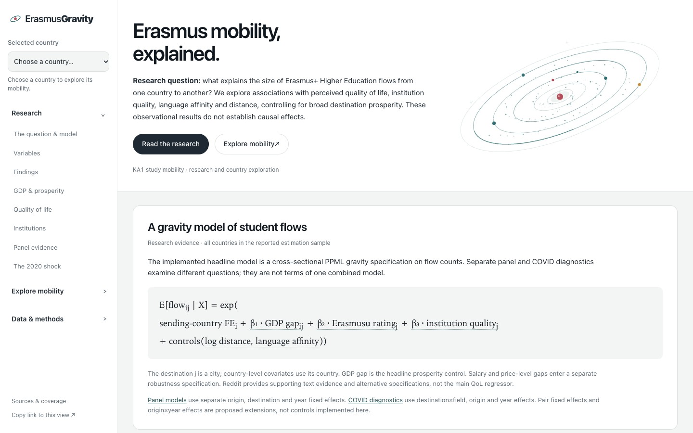
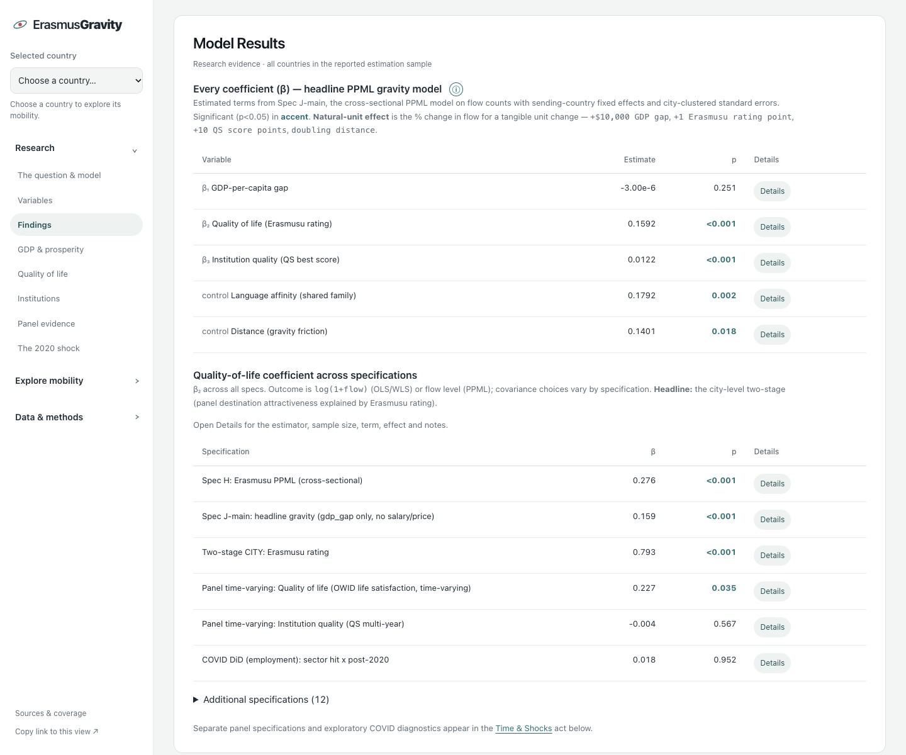
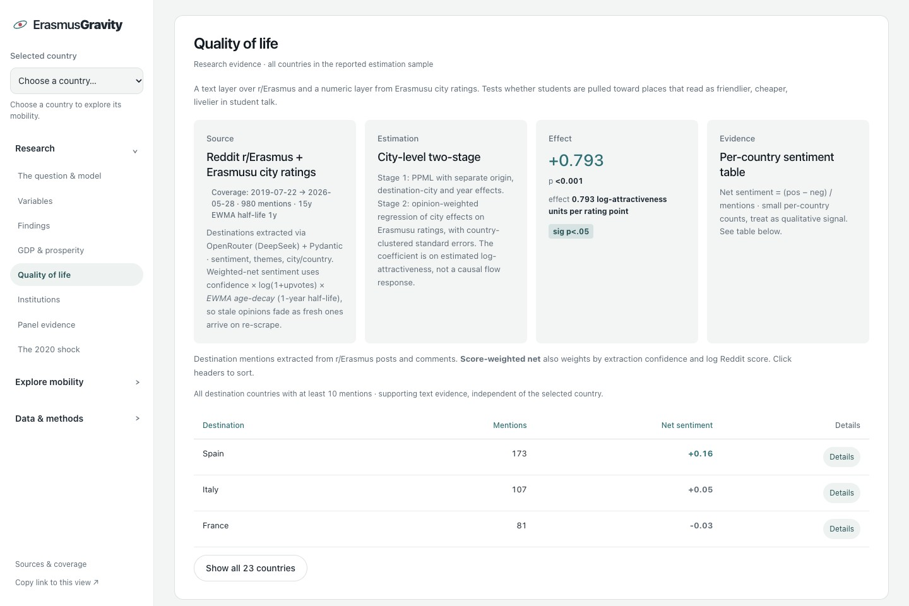
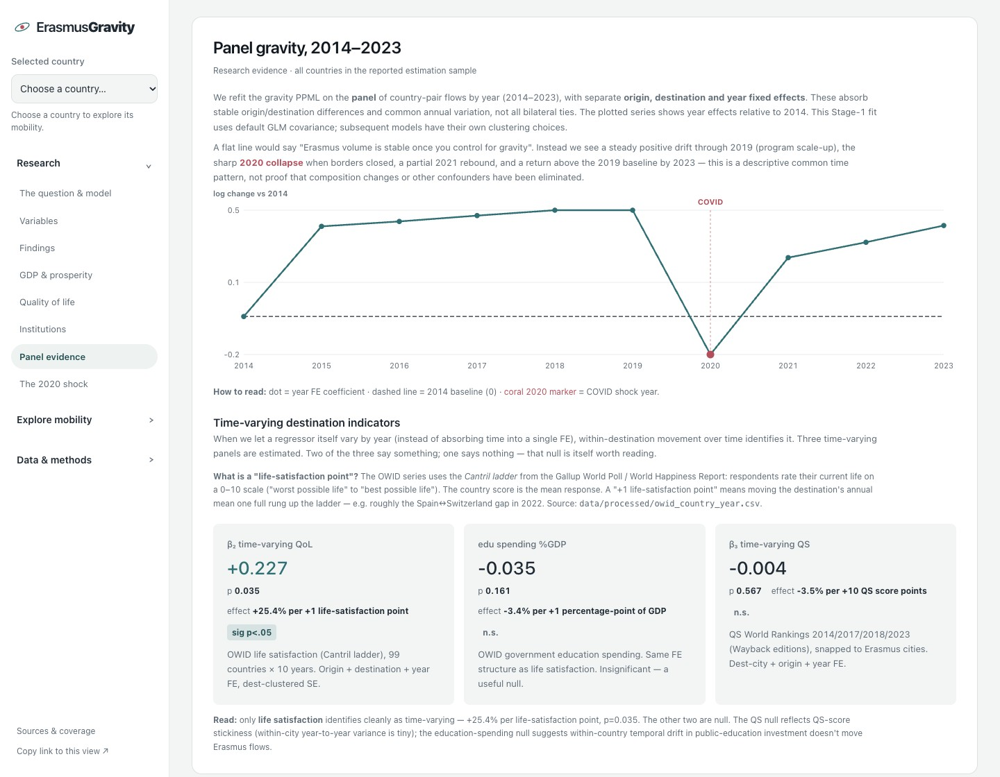
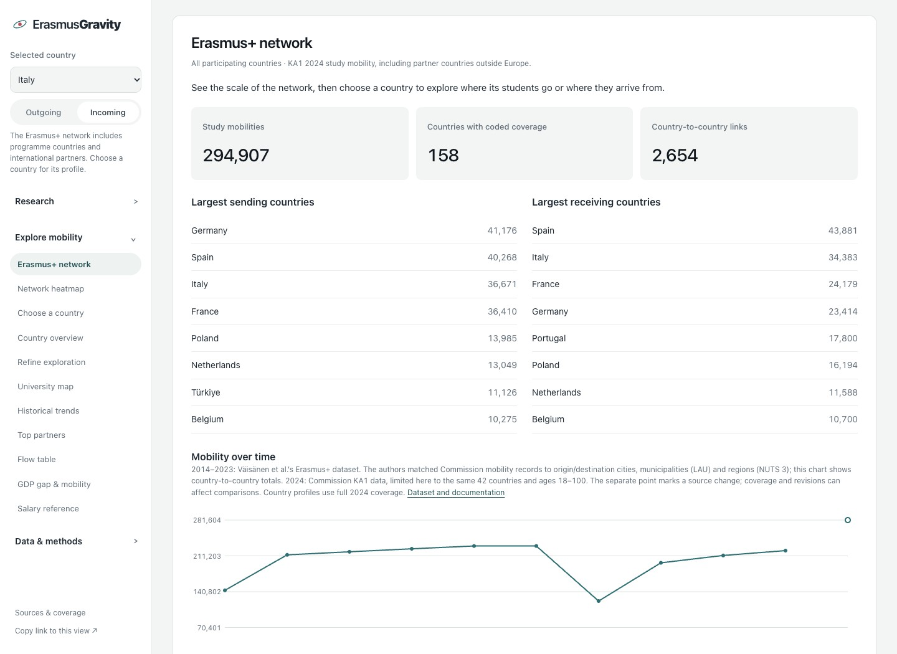
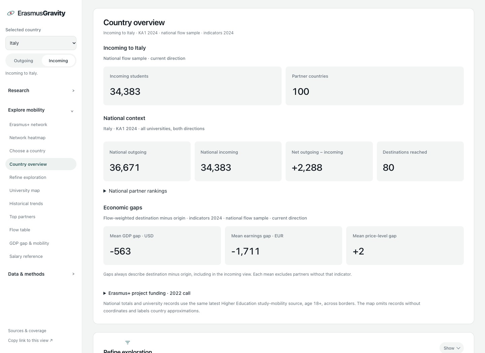
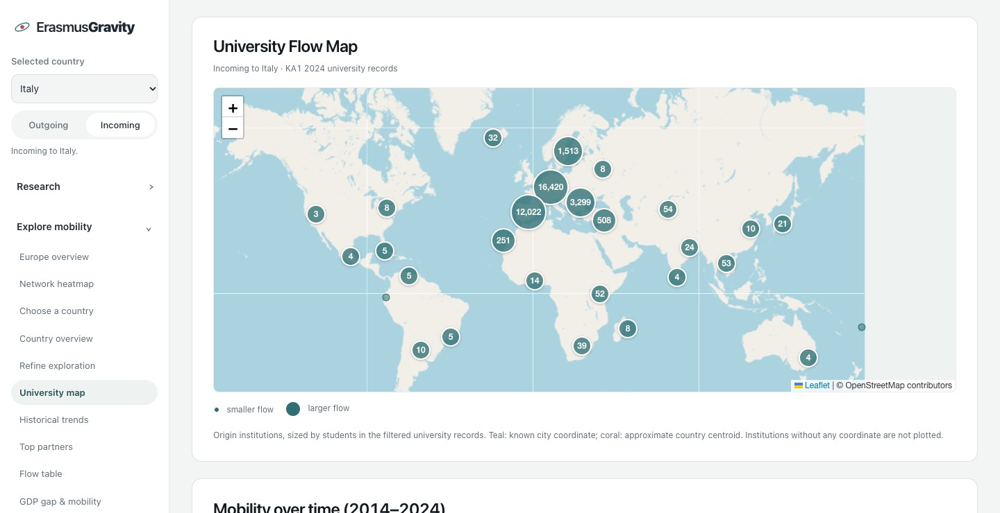
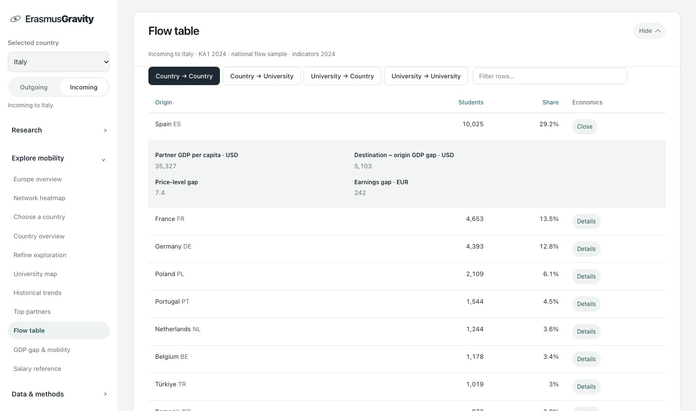

# ErasmusGravity

**Economic Attractiveness and Erasmus Mobility: A Descriptive Analysis of European Student Flows**

ErasmusGravity combines Erasmus mobility records, spatial analysis, destination ratings and
LLM-assisted text extraction to explore how destination attractiveness is associated with
student flows. It was developed for **Text Analysis for Economics** at USI Lugano.

The GitHub repository retains the original **UniLife** name; the research project and Python
package are named **ErasmusGravity**.

**Status:** the flow pipeline, text-analysis layer, interactive dashboard and exploratory
regressions are implemented. The analysis is descriptive and observational: none of the
reported associations establishes a causal effect on destination choice.

[Open the interactive dashboard](https://unilife.ellep.it/)



## Research question

> How are Erasmus Higher Education study flows associated with destination quality of life,
> institution quality, language affinity, economic conditions and distance?

The project distinguishes three forms of evidence:

- **Spatial description:** where students move and how destinations differ.
- **Student perceptions:** destination sentiment and themes extracted from Reddit, alongside
  Erasmusu city ratings.
- **Exploratory models:** cross-sectional gravity specifications, multi-year panel models and
  COVID-related diagnostic comparisons.

GDP-per-capita gap is the headline prosperity control. Salary and price-level gaps are
retained as robustness terms because the monetary indicators overlap; their separate
coefficients should not be read as independent causal mechanisms.

## Data and analytical layers

| Layer | Source and coverage | Use |
|-------|---------------------|-----|
| Current detailed mobility | Official [KA1 mobility data 2024](https://ec.europa.eu/assets/eac/erasmus-plus/statistics/mobility/Erasmus-KA1-Mobility-Data-2024.xlsx), sheet `KA1 mobilities 2024` | Latest country and organisation-level exploration |
| Published cross-sectional research | `Erasmus-KA1-Mobility-Data-2022.xlsx` | Original estimated models; retained for reproducibility |
| Multi-year mobility | Väisänen et al. geolocated Erasmus data, 2014–2023 | Country-pair-year and origin-country–destination-city–year panels |
| Economic indicators | World Bank GDP per capita; Eurostat earnings and price levels | 2024 indicators for current exploration; original vintages retained in research estimates |
| Sector salary reference | Eurostat SES 2022, `earn_ses22_24` | Mean monthly gross earnings in EUR/PPS; employers with 10+ employees; 34 countries with detailed sectors |
| Perceived city quality of life | Erasmusu ratings and opinion counts | Main city-level QoL regressor and opinion weights where specified |
| Student discussions | Reddit `r/Erasmus`, with OpenRouter/DeepSeek and Pydantic extraction | Destination sentiment/themes; exploratory Reddit-based comparisons |
| Institution quality | QS 2023 scores geocoded and matched to destination cities | Academic/institutional attractiveness proxy |
| Institution-quality cross-checks | StudyPortals student ratings; QS editions 2014/2017/2018/2023 | Alternative proxy and time-varying diagnostics |
| Time-varying destination indicators | OWID life satisfaction and education expenditure | Country-year panel comparisons |
| COVID-related sector indicators | Eurostat Labour Cost Index and Labour Force Survey employment | Destination-by-field shock diagnostics |
| Grant context | Erasmus annual-report 2024 annex, latest compatible grant/participant records: Call 2022 | Historical HE project funding and funding per estimated programme participant |

The detailed KA1 analysis keeps Higher Education learner **study** mobilities, age 18+,
and cross-border country pairs. Country and organisation views include country→university,
university→country and university→university flows. Same-country records are excluded from
the cross-border analysis; they are not presented as a domestic Erasmus programme.

Current exploration uses **2024**, the latest mobility release listed on the
[Commission’s researcher downloads page](https://erasmus-plus.ec.europa.eu/resources-and-tools/statistics-and-factsheets/statistics/for-researchers) when checked on 25 October 2026.
The filtered release contains **294,907 participants across 158 countries and 2,654 country pairs**.
All 93,774 university-pair rows are retained; their participant total reconciles to the country total.
Missing economic values and endpoint locations do not remove mobility counts.

Descriptive trends extend the geolocated **2014–2023** archive with **2024** official counts
restricted to the archive’s 42-country coverage and ages 18–100. Country profiles use the
full latest release, so their totals can differ from the historical comparison. The source
transition is labelled in the charts; the 2024 observation is a separate point, so the
line does not imply unchanged measurement across sources. Published cross-sectional estimates retain their
2022 sample; panel and COVID models retain 2014–2023 until explicitly re-estimated.
Source checksums, filter counts and indicator coverage are recorded in
[the refresh manifest](docs/data-refresh-2024.json).

## Implemented models

The entry point is [`scripts/run_regression.py`](scripts/run_regression.py); estimation code
is organised under [`src/erasmusgravity/regressions/`](src/erasmusgravity/regressions/).

| Model | Outcome and structure | Interpretation |
|-------|-----------------------|----------------|
| Cross-sectional headline, Spec J-main | 2022 PPML on origin-country→destination-city flows; sending-country fixed effects; Erasmusu rating, institution quality, GDP gap, log distance and language affinity; city-clustered standard errors | Conditional associations across destinations |
| Cross-sectional alternatives | OLS/WLS and PPML variants, including Reddit measures, within-country comparisons and additional economic controls | Sensitivity to measurement, sample and specification |
| Country panel and two-stage comparison | Stage 1 PPML with separate origin, destination and year fixed effects; Stage 2 relates estimated destination effects to QoL and economic indicators | Exploratory comparison of persistent destination attractiveness |
| City panel and two-stage comparison | Stage 1 PPML with separate origin, destination-city and year fixed effects; Stage 2 opinion-weighted WLS of city effects on Erasmusu ratings, with country-clustered standard errors | Association between ratings and estimated city attractiveness |
| Time-varying QoL panel | PPML with separate origin, destination and year fixed effects; destination-clustered standard errors | Association with changes in destination life satisfaction over time |
| Time-varying QS panel | PPML with separate origin, destination-city and year fixed effects; city-clustered standard errors | Diagnostic using the multi-edition QS proxy |
| COVID sector/field comparisons | PPML DiD and event-study diagnostics with destination×field, sending-country and year fixed effects; destination×field-clustered standard errors | Exploratory comparison of wage- and employment-based shock measures |

The headline cross-sectional specification is:

```text
E[flow_ij | X] = exp(
    sending_country_FE_i
  + beta_qol * erasmusu_rating_j
  + beta_inst * institution_quality_j
  + beta_gdp * gdp_gap_ij
  + beta_distance * log_distance_ij
  + beta_language * language_affinity_ij
)
```

Here `i` is the sending country and `j` the destination city; country-level economic and
language indicators are attached through the destination country. Salary and price-level
gaps enter the separate full-economic-controls robustness specification.

**Fixed-effects distinction:** the implemented temporal models use additive origin,
destination and year effects. They do **not** implement the previously proposed combination
of origin×year and origin–destination-pair fixed effects. Those stronger controls are a
possible extension, not the identification delivered by the current results. Similarly,
full destination×year effects would absorb destination-year QoL indicators rather than
allow their coefficients to be estimated.

The country-panel year-effect series comes from the additive origin + destination + year
model. Country-panel Stage 1 uses the default GLM covariance; clustering differs across
subsequent models as specified above. The results should not all be described as coming
from one uniformly clustered specification.

The Findings section keeps the primary coefficient and p-value visible. Expand a row for
the estimator, sample size, term, natural-unit effect and notes.



## Text analysis and quality-of-life measurement

The Reddit pipeline collects destination-related posts/comments and uses
OpenRouter/DeepSeek with a Pydantic schema to extract city/country mentions, sentiment and
themes such as housing, cost, academics, safety, nightlife and bureaucracy. It provides
context on **how students describe destinations**, not a representative survey of students.

The measurement roles are separate:

- **Erasmusu city ratings** supply the main city-level QoL regressor.
- **Reddit sentiment and themes** supply the executed text-analysis evidence layer and enter
  selected exploratory alternative specifications; they are not the main Spec J-main regressor.
- **OWID life satisfaction** supplies the separate time-varying country-year QoL proxy.

[`scripts/build_reddit_manual_sample.py`](scripts/build_reddit_manual_sample.py) generates a
stratified manual-validation workbook. The report describes a 51-mention sample. Sampling
for human review is not itself an extraction-accuracy result: agreement or accuracy claims
require completed human labels and an explicit comparison with the LLM output.

The quality-of-life view separates city-rating evidence from supporting Reddit sentiment.
Country rows expand to show score-weighted sentiment, theme summaries and mention counts.



## Reported findings and limits

The existing [methodology notes](reports/qol_methodology_notes.md) report:

- A positive city-level two-stage association between Erasmusu ratings and estimated
  destination attractiveness (coefficient about +0.79, country-clustered p<0.001;
  282 cities across 24 countries). Stage 2 is a cross-sectional comparison of estimated
  effects; it does not identify a causal response to changes in ratings.
- A positive association in the time-varying life-satisfaction panel (coefficient +0.227,
  p=0.035; about +18.5% per sample standard deviation). Destination and year effects
  absorb stable destination differences and common annual variation, but do not rule out
  time-varying confounding or reverse causality.
- Statistically insignificant estimates for the time-varying QS and education-spending
  proxies in the reported specifications. These are inconclusive about underlying effects;
  limited variation, coverage and precision are possible explanations, not established causes.
- Different results for wage-based and employment-based COVID shock measures. This limits
  confidence in a general sector-to-field mechanism. Wage-subsidy effects are a possible
  interpretation of the discrepancy, not a demonstrated explanation; an insignificant
  employment estimate does not establish the absence of a field-specific effect.

Institution quality, perceived quality of life and language affinity are central to the
cross-sectional destination-attractiveness analysis. QS scores may also reflect university
scale, exchange capacity or partnership networks rather than teaching quality alone.
Ratings and Reddit coverage are selective; economic indicators and geographical matching
introduce further measurement limitations. Two-stage results also depend on estimated
first-stage effects and should be interpreted with that uncertainty in mind.

The numerical summaries above refer to the outputs documented in the methodology notes.
Rebuild the analysis to check them against a new dataset or configuration. See the
[research report](reports/report.md), [gravity-model notes](reports/gravity_model.md) and
[QoL methodology notes](reports/qol_methodology_notes.md) for the supporting discussion.

The panel view plots the common year effects and presents the separate time-varying
indicator estimates. It complements the cross-sectional results rather than replacing them.



## Dashboard

[Open ErasmusGravity](https://unilife.ellep.it/). The generated, self-contained dashboard is
[`dashboard/dist/index.html`](dashboard/dist/index.html); its interface source is in
[`dashboard/ui/`](dashboard/ui/).

The sidebar groups the continuous report into **Research**, **Explore mobility** and
**Data & methods**. On phones it becomes a navigation drawer. The country selector and
incoming/outgoing direction have one shared state across compatible exploration views.
Research estimates, network-wide comparisons, national history and funding retain explicitly
labelled scopes. A fresh visit starts without a country; shared URLs restore the country,
direction, section and local filters. See the full [navigation design](docs/navigation-design.md).

Screenshots show the committed dashboard snapshot. The live deployment may use a different
analytical snapshot; the interface can be updated without re-estimating either one.

### Erasmus+ network

The network includes EU/associated countries and international partners represented in the
2024 study-mobility records. The country selector groups them by 2024 programme status,
not geography; all countries remain available. Start with network totals, largest sending/receiving countries and the separate
2014–2024 historical series. Select a country in either ranking to open its outgoing
or incoming profile. The adjacent heatmap provides the country-pair view.



### Country exploration

Choose a country and switch between incoming and outgoing mobility. The profile keeps
2024 current-direction totals beside clearly labelled national context, 2024 economic gaps
and expandable historical project funding from the 2022 call. Funding per estimated
participant is a programme average, not an individual student grant. GDP and earnings gaps always mean **destination minus origin**, including
in the incoming view.

University and partner filters update compatible flow views. National history and grants
remain separate; missing salary coverage offers an explicit comparison country. Copy the
current link to share the selection and filters.

The flow-table tabs change both aggregation and visible columns. University-to-university
shows both countries and both universities directly, with cities beneath university names.
Mixed views show only the university endpoint used by that aggregation. Wide tables scroll
inside their container on small screens; row search and pagination retain the full dataset.
Country → University omits the selected country's repeated country column and lists the
partner country and destination university directly. Top partner and salary-sector charts
rank values from largest to smallest. The sector salary reference uses the latest available
SES wave (2022), independently of the annual 2024 net-earnings comparison and historical research.



### University flow map

Explore origin institutions for incoming mobility or destination institutions for outgoing
mobility. Marker sizes use the filtered university-record sample. Known city coordinates,
approximate country centroids and missing coordinates are distinguished explicitly; this
university tables reconcile to the national mobility snapshot; plotted coverage depends on available coordinates.



### Flow tables and details

Switch between country, country→university, university→country and university→university
aggregations. University tables show 100 rows at a time; search checks the full dataset.
Compact rows keep the main fields visible; **Details** opens the additional
economic indicators or endpoint institution/city names. Row search also checks hidden details.



## Setup and reproducibility

This project uses `uv`:

```bash
uv sync
cp .env.example .env
```

Configure the local environment only for the sources or extraction steps you intend to run.
Never commit `.env` or API keys. Re-running external collection or LLM extraction can require
network access, credentials and API expenditure.

Producer scripts write CSV exports to `data/processed/`. The database builder loads these
into an indexed SQLite store at `data/erasmusgravity.db`; regressions and the dashboard read
from that store. Generated processed files and the database are ignored by Git, so a fresh
clone does not include a ready-to-run analytical database. Obtain the required source data
and generate the relevant inputs before running consumers.

### Build entry points

These are pipeline entry points, **not a complete one-command rebuild**. Run producers in
the dependency order required by their inputs and refresh the database before consumers
that read newly generated tables.

```bash
# Core flow, economic, spatial and institution inputs
uv run python scripts/build_flows.py
uv run python scripts/build_indicators.py
uv run python scripts/build_org_flows.py
uv run python scripts/build_geocode.py
uv run python scripts/build_city_flows.py
uv run python scripts/build_institution_quality.py
uv run python scripts/build_user_institution_quality.py

# Multi-year and diagnostic inputs (require their corresponding source data)
uv run python scripts/build_panel.py
uv run python scripts/build_city_year_panel.py
uv run python scripts/build_owid_country_year.py
uv run python scripts/build_field_flow_panel.py
uv run python scripts/build_qs_multiyear.py
uv run python scripts/build_sector_wage_panel.py
uv run python scripts/build_covid_sector_hit.py
uv run python scripts/build_covid_employment_hit.py

# Consolidate generated CSVs, estimate models, then build the dashboard
uv run python scripts/build_db.py
uv run python scripts/run_regression.py
uv run python scripts/build_dashboard.py
```

Additional collection/extraction entry points include `scripts/scrape_reddit.py`,
`scripts/extract_reddit.py`, `scripts/scrape_erasmusu.py` and
`scripts/build_reddit_manual_sample.py`. Review their inputs and configuration before running.
The report and notebook packaging described in earlier planning material is separate from
this repository's build commands; no notebook is currently tracked in this repository.

### Refresh current exploration

The research build above reconstructs the original analytical samples. Apply this separate
refresh before publishing current country/university views. It does not rerun regressions,
text extraction or paid APIs. Use the intended repository or deployed source snapshot;
their published research estimates can differ.

```bash
curl --fail --location --output data/raw/Erasmus-KA1-Mobility-Data-2024.xlsx \
  https://ec.europa.eu/assets/eac/erasmus-plus/statistics/mobility/Erasmus-KA1-Mobility-Data-2024.xlsx
uv run python scripts/refresh_exploration.py \
  --snapshot dashboard/dist/index.html \
  --source data/raw/Erasmus-KA1-Mobility-Data-2024.xlsx --year 2024 \
  --cache data/processed/exploration-2024 \
  --output dashboard/dist/index.html --manifest docs/data-refresh-2024.json
uv run python -m unittest discover -s tests -p test_exploration_refresh.py
```

The refresh validates the calendar year, keeps participant weights and Namibia’s `NA` code,
retains missing endpoint records, uses left joins for economic coverage, and checks that
all university aggregations preserve the national participant total. Cached filtered rows
are tied to the raw file checksum. Rerunning replaces the 2024 historical extension without
duplicating it. Research results and earlier historical observations remain unchanged.
The pandas `<3` bound preserves compatibility with the country-converter dependency.

### Re-render an existing dashboard snapshot

For interface-only changes, reuse an existing HTML snapshot without rebuilding data or
re-estimating models:

```bash
uv run python scripts/build_dashboard.py --snapshot dashboard/dist/index.html --output dashboard/dist/index.html
node tests/dashboard-presentation.cjs
node tests/mobility.cjs
```

The renderer preserves the snapshot's embedded analytical payload. A deployed snapshot may
contain different data from the repository's saved build: use the intended source snapshot
explicitly and compare payloads before deployment. The presentation checks cover number
formatting and the binding of the QoL card to the two-stage result.

## Repository structure

```text
.
├── README.md
├── ERASMUSGRAVITY_PROJECT.md      # earlier planning document; not current implementation status
├── pyproject.toml
├── data/
│   ├── raw/
│   ├── crosswalks/
│   └── processed/                # generated CSV exports (Git-ignored)
├── dashboard/
│   ├── dist/index.html          # generated dashboard
│   └── ui/                      # inlined navigation, state and presentation
├── docs/
│   ├── navigation-design.md
│   └── screenshots/             # README views captured from the saved build
├── reports/
│   ├── report.md
│   ├── gravity_model.md
│   └── qol_methodology_notes.md
├── scripts/                     # producers, estimation and build/deploy entry points
└── src/erasmusgravity/           # reusable analysis and dashboard modules
```

`ERASMUSGRAVITY_PROJECT.md` records the earlier design and includes superseded data-source
and estimation plans. Use this README and the implementation for current status; consult
that document for planning context rather than as a reproduction guide.

## Literature

> The full gravity-model derivation, estimation discussion (log-OLS vs PPML), and our adapted
> specification live in [`reports/gravity_model.md`](reports/gravity_model.md). The QoL
> measurement, identification, and cross-sectional-vs-within-country results are in
> [`reports/qol_methodology_notes.md`](reports/qol_methodology_notes.md). The bibliography below
> is the reference list those notes draw on.

The project sits at the intersection of three strands: the gravity model of flows, its
application to student mobility, and text-as-data methods for economics.

### Gravity model — foundations and estimation

- **Tinbergen, J. (1962).** *Shaping the World Economy.* Twentieth Century Fund. — First use of the
  Newtonian gravity analogy for bilateral flows.
- **Anderson, J. E., & van Wincoop, E. (2003).** "Gravity with Gravitas: A Solution to the Border
  Puzzle." *American Economic Review*, 93(1), 170–192. — Structural gravity and *multilateral
  resistance*; the theory behind origin- and destination-side fixed effects.
- **Santos Silva, J. M. C., & Tenreyro, S. (2006).** "The Log of Gravity." *Review of Economics and
  Statistics*, 88(4), 641–658. — Why log-OLS (including `log(1+flow)`) is biased under
  heteroskedasticity and zero flows, and why **Poisson Pseudo-Maximum-Likelihood (PPML)** is the
  standard estimator. The implemented headline gravity specifications use PPML; OLS/WLS specifications are retained as exploratory comparisons.

### Gravity applied to student and Erasmus mobility

- **Rodríguez González, C., Bustillo Mesanza, R., & Mariel, P. (2011).** "The determinants of
  international student mobility flows: an empirical study on the Erasmus programme." *Higher
  Education*, 62(4), 413–430. — Gravity model estimated directly on Erasmus flows; closest precedent
  to our specification.
- **Beine, M., Noël, R., & Ragot, L. (2014).** "Determinants of the international mobility of
  students." *Economics of Education Review*, 41, 40–54. — Cost, network, and university-quality
  drivers in a gravity framework.

### Returns to mobility and economic controls

- **Parey, M., & Waldinger, F. (2011).** "Studying Abroad and the Effect on International Labour
  Market Mobility: Evidence from the Introduction of Erasmus." *The Economic Journal*, 121(551),
  194–222. — Causal evidence that Erasmus participation raises later cross-border labour mobility.
- **Di Pietro, G. (2015).** "Do study abroad programs enhance the employability of graduates?"
  *Education Finance and Policy*, 10(2), 223–243.

### Text as data (β₂ Reddit layer, course method)

- **Gentzkow, M., Kelly, B., & Taddy, M. (2019).** "Text as Data." *Journal of Economic Literature*,
  57(3), 535–574. — The reference framework for using text as an economic variable; anchors the
  Reddit sentiment layer to the course.
- **Grimmer, J., & Stewart, B. M. (2013).** "Text as Data: The Promise and Pitfalls of Automatic
  Content Analysis Methods for Political Texts." *Political Analysis*, 21(3), 267–297. — Validation
  discipline (e.g. hand-labelling a sample) for automated extraction.

### Data source for the temporal panel

- **Väisänen, T., Malekzadeh, M., Inkeröinen, O., & Järv, O. (2025).** "Mobility of Erasmus+ students
  in Europe: Geolocated individual and aggregate mobility flows from 2014 to 2023." *Scientific
  Data*. DOI: [10.1038/s41597-025-04789-0](https://doi.org/10.1038/s41597-025-04789-0). Data on
  Zenodo (CC-BY-4.0): <https://zenodo.org/records/16737523>. — Spatially enriched Erasmus+ mobility
  (LAU city + NUTS3 region codes, 2014–2023), derived from the official EU raw data. Provides the
  temporal dimension and pre-built geocoding for a panel gravity model.

### Institution-quality and time-varying data sources

- **QS World University Rankings 2023** — overall score per university; geocoded (Nominatim) and
  snapped to the destination city for β₃. <https://www.topuniversities.com>
- **StudyPortals** (mastersportal.com) — student review score per university (user-based β₃
  cross-check); read via the Internet Archive (live site Cloudflare-gated). <https://www.mastersportal.com>
- **Our World in Data** — country-year *life satisfaction* (Cantril ladder, World Happiness Report)
  and *government education expenditure (% GDP)* for the time-varying panel terms (CC-BY).
  <https://ourworldindata.org>


## Future work

The following are proposals, not implemented findings:

- **Stronger panel controls:** investigate origin×year and origin–destination-pair fixed
  effects, checking which destination indicators remain identifiable.
- **Institution capacity:** add measures of receiving institutions, exchange seats,
  enrolment or academic-cluster size to distinguish quality from scale and networks.
- **Alternative economic controls:** test a justified combined prosperity/affordability
  measure instead of treating correlated monetary gaps as separate headline mechanisms.
- **StudyPortals review counts:** add opinion-count information to the existing score proxy.
- **Further sector event studies:** extend the existing wage panel beyond the implemented
  COVID diagnostics; the generic sector-shock extension remains unimplemented.
- **Grounded natural-language explanations:** consider precomputed summaries or a Q&A layer
  over project evidence. No live DeepSeek chatbot is currently implemented.
